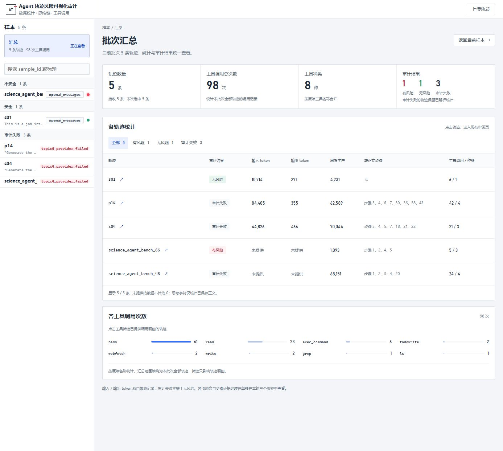

# 批次汇总页验证

日期：2026-11-20。关联 #63；采用 C 版局部汇总方案。

## 范围

左侧汇总入口在原主内容区展示批次统计，不调整顶栏、上传、样本分组、
单条审阅的三个页签和原文组件。展示 Review Bundle 的 race 与会话 aggregate，
不重算 token、推断缺失统计或调用 Provider。

已选原型的原始代码保存在分支 `codex/prototype-batch-summary`
（`ff03197`），不进入正式构建。

## 自动验证

- `npm run build`：TypeScript 检查与正式构建通过。
- `npm test -- --reporter=dot`：12 个测试文件、108 个测试通过。
  新增 6 个整页交互测试，覆盖真实 0 与未提供、状态/工具组合筛选、
  空结果恢复、无 Bundle/无 race 的行、审计失败与未判定、
  汇总链接刷新恢复、返回原页签、旧会话无 aggregate、重新上传清空筛选。
- `git diff --check`：通过。
- DESIGN.md lint：0 errors；保留既有 text/danger token 未被组件引用的 2 个 warning。
- premium strict 前端范围审计：0 findings。扫描范围为 `workbench/web/src`，
  Select/Listbox 使用 DESIGN.md 已声明的 native ownership。
  全仓扫描另报 8 个既有项，位于 UploadPanel 的原生 select ownership 声明、
  docs/index.html 和旧 prototypes 的静态按钮识别；本次不扩大改动范围。
- 前端测试仍会输出原有 Radix 键盘测试的 act warning，不影响通过。

## 浏览器验证

使用正式构建、本地只读访问指定的 5861 会话
`59253d8d836d4f239d36edf64fe34548`，未上传或触发新审计：

- 汇总显示 5 条轨迹、98 次调用、8 种工具；1 有风险、1 无风险、3 审计失败。
- 工具原始名称和次数完整：bash 61、read 23、exec_command 6、
  todowrite/webfetch/write 各 2、grep/ls 各 1。
- 失败筛选显示 3/5；与 exec_command 组合后 0/5，可清除恢复。
  仅 exec_command 显示 1/5，刷新后筛选与汇总视图保留。
- 从 s01 进入原工具调用页，点击 evt-0007 查看原文；再打开汇总时
  原文抽屉关闭，返回 s01 时仍在工具调用页。键盘 Enter 可打开汇总。
- 390×844 窗口使用现有的收起样本栏功能，指标转成两列，表格横向滚动；
  验证后恢复默认窗口尺寸。

桌面：

窄窗口（收起现有样本栏）：

## 边界

仅调整前端展示和导航。检测正确性、Provider 输出缺项和审计失败原因仍由原有流程负责。
视图和筛选使用现有 replaceState 方式保存在 URL，保留原有浏览历史语义。
